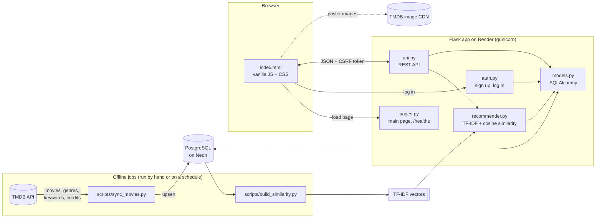

# CineMatch

A full-stack movie recommendation app. Search thousands of movies, rate the ones you've seen, and CineMatch suggests what to watch next based on genres, keywords, cast, directors and plot. Built with Flask, SQLAlchemy and PostgreSQL, with a vanilla JavaScript frontend that works on desktop and phone.

Movie data comes from the TMDB API and is synced into my own database, so the recommender runs on local data instead of calling TMDB on every request.

**Live demo:** _coming soon_

<!--  -->

<!--
<p align="center">
  
  &nbsp;&nbsp;
  
</p>
-->

## Features

**Movies**
- Search movies by title, filter by genre and sort by rating, popularity or release date
- Movie page with poster, overview, runtime, director and top cast
- "More like this" row on every movie
- Dark mode
- Phone layout: sidebar first, tap a section to open it, the back gesture returns to the sidebar

**Ratings and recommendations**
- Rate movies from 1 to 5 stars, change or remove a rating any time
- "For you" page built from the movies you rated highly
- Movies you already rated never show up as recommendations
- New users see popular and top-rated movies until they've rated a few

**Accounts**
- Sign up and log in, each user only sees their own ratings
- Display name and password change

## Architecture



- **Offline jobs** fill the database and build the recommendation data, so a page load never waits on TMDB.
- **The Flask app** serves one page (`index.html`); after that, the browser talks to the server only through the JSON API.
- **The recommender** reads the precomputed TF-IDF vectors and the user's ratings from the database, then returns movie ids for the API to look up.
- **Posters** load straight from TMDB's image CDN, so the server never stores images.

## How recommendations work

1. `scripts/sync_movies.py` pulls movies, genres, keywords and credits from TMDB into PostgreSQL. It's safe to run again: existing movies are updated, not duplicated.
2. `scripts/build_similarity.py` builds a text profile for every movie (genres, keywords, top cast, director, overview), turns the profiles into TF-IDF vectors and saves them.
3. **Similar movies:** the movies whose vectors are closest by cosine similarity.
4. **For you:** similarity scores added up across your highly rated movies, minus anything you've already rated, with a minimum vote count so obscure films don't take over.

## Tech stack

| Part | Tools |
|---|---|
| Backend | Python, Flask, REST API (JSON) |
| Database | SQLAlchemy, Flask-Migrate (Alembic), PostgreSQL on Neon, SQLite locally |
| Data | TMDB API, requests |
| Recommender | scikit-learn (TF-IDF, cosine similarity) |
| Auth and security | Flask-Login, Werkzeug password hashing, Flask-WTF (CSRF), Flask-Limiter |
| Frontend | HTML, CSS, vanilla JavaScript (no framework) |
| Testing | pytest, pytest-cov |
| Deployment | Render (gunicorn), Neon |

## Security

- Passwords are stored as salted hashes, never in plain text
- Ratings are always looked up for the logged-in user, so nobody can read or change someone else's
- CSRF tokens on every form and API call, plus `SameSite=Lax`, `HttpOnly` and `Secure` cookies
- Rate limits on login and sign up
- All secrets (TMDB key, database URL, `SECRET_KEY`) come from environment variables, the app refuses to start without `SECRET_KEY`

## Run it locally

Needs Python 3.12 or newer and a free [TMDB API key](https://www.themoviedb.org/settings/api).

```powershell
git clone https://github.com/BenNguyen0204/CineMatch.git
cd CineMatch
python -m venv .venv
.venv\Scripts\Activate.ps1          # macOS / Linux: source .venv/bin/activate
pip install -r requirements-dev.txt
```

Copy `.env.example` to `.env` and fill in `SECRET_KEY` and `TMDB_API_KEY`:

```powershell
python -c "import secrets; print(secrets.token_hex(32))"
```

Leave `DATABASE_URL` empty to use a local SQLite file, or paste your Neon connection string.

```powershell
flask --app wsgi db upgrade              # create the tables
python -m scripts.sync_movies            # load movies from TMDB
python -m scripts.build_similarity       # build the recommendation data
flask --app wsgi run                     # http://127.0.0.1:5000
```

## Tests

```powershell
pytest              # run all tests
pytest --cov=app    # with coverage
```

Each test gets a fresh app and a temporary database, and TMDB calls are mocked so tests never hit the network. They cover login protection, rating CRUD, input validation, users not being able to change each other's ratings, and the recommender (right number of results, no already-rated movies, unknown ids).

## API

Routes marked with a lock need a logged-in user. All routes return JSON.

| Method | URL | What it does |
|---|---|---|
| `GET` | `/api/movies?q=&genre=&sort=` | Search, filter and sort movies |
| `GET` | `/api/movies/<id>` | One movie with genres, cast and director |
| `GET` | `/api/movies/<id>/similar` | Movies similar to this one |
| `GET` | `/api/genres` | All genres, for the filter menu |
| `GET` 🔒 | `/api/ratings` | All of my ratings |
| `PUT` 🔒 | `/api/ratings/<movie_id>` | Rate a movie (1–5) or change the rating |
| `DELETE` 🔒 | `/api/ratings/<movie_id>` | Remove a rating |
| `GET` 🔒 | `/api/recommendations` | My personalized recommendations |
| `GET` / `PATCH` 🔒 | `/api/account` | Read or update display name |
| `POST` 🔒 | `/api/account/password` | Change password |

## Project structure

```text
app/
  __init__.py          app factory, config, security settings
  extensions.py        db, migrate, login manager, csrf, limiter
  models.py            User, Movie, Genre, Keyword, Person, Rating
  api.py               REST API: movies, ratings, recommendations, account
  auth.py              sign up, log in, log out
  pages.py             main page, /healthz
  recommender.py       TF-IDF similarity and recommendations
  tmdb.py              TMDB API client
  templates/
    index.html         the app: sidebar + main panel
    auth.html          log in / sign up
  static/
    styles/
      variables.css    colors, font, light and dark theme
      base.css         reset, body, buttons
      sidebar.css      sidebar: Home, Search, My ratings, For you
      app.css          main panel: top bar, search box, filter and sort menus
      movies.css       movie cards, poster grid, movie page, star rating
      toast.css        pop-up messages
      auth.css         log in / sign up page
      mobile.css       phone layout
    scripts/
      main.js          starts the app, switches between views
      api.js           fetch helpers, sends the CSRF token
      sidebar.js       sidebar navigation
      movieRender.js   draws movie cards and the movie page
      search.js        search box, genre filter, sort
      rating.js        star rating clicks
      account.js       account panel: display name, password
      theme.js         dark mode
      toast.js         pop-up messages
      mobile.js        phone navigation and back gesture
    images/            icons (filter, sort, dark mode, star)
scripts/
  sync_movies.py       TMDB -> database
  build_similarity.py  precomputes the TF-IDF vectors
migrations/            database migrations
tests/
  test_app.py          routes, auth, ratings
  test_recommender.py  recommender
docs/screenshots/      images for this README
wsgi.py                entry point for gunicorn
requirements.txt       packages for the server
requirements-dev.txt   + pytest, for development
pytest.ini
.env.example           copy to .env and fill in
.gitignore             keeps .env, .venv/ and notes/ out of Git
```

## Deployment

Runs on Render's free plan with a Neon PostgreSQL database.

- Build: `pip install -r requirements.txt`
- Start: `flask --app wsgi db upgrade && gunicorn wsgi:app --workers 1 --threads 4 --bind 0.0.0.0:$PORT`
- Health check: `/healthz`
- Environment variables: see `.env.example`

## What's next

- Weekly job to sync new releases from TMDB
- "Why this recommendation?" (shared genres and actors)
- Collaborative filtering once there's enough rating data
- Run the tests automatically on every push

---

This product uses the TMDB API but is not endorsed or certified by TMDB.
